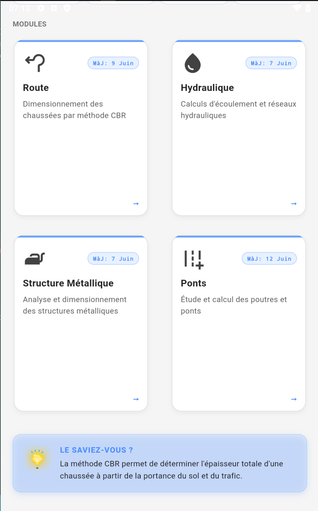
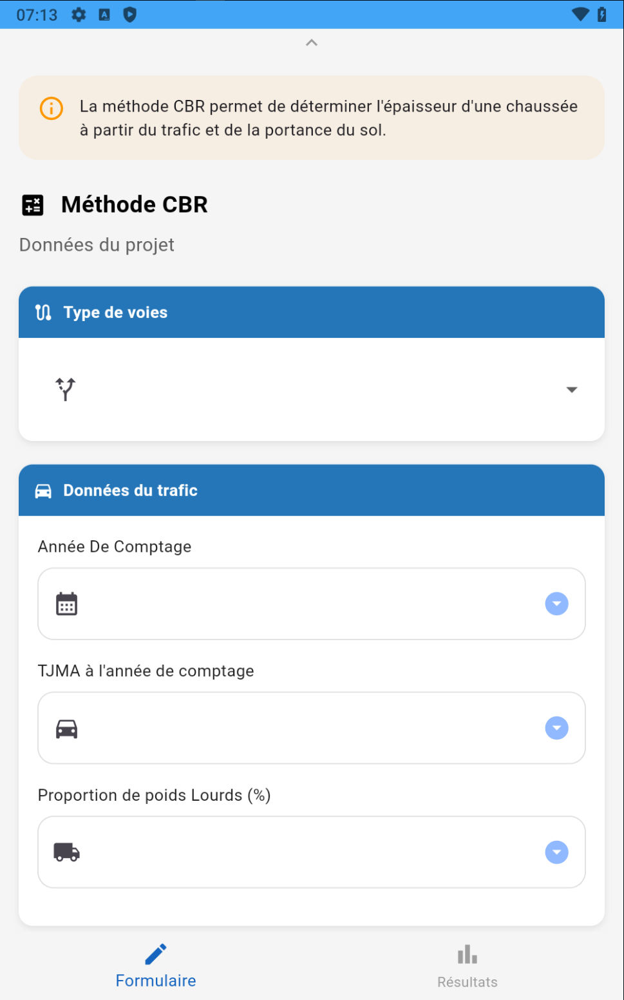
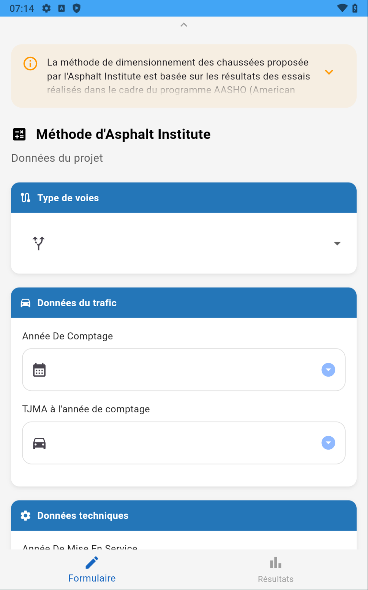
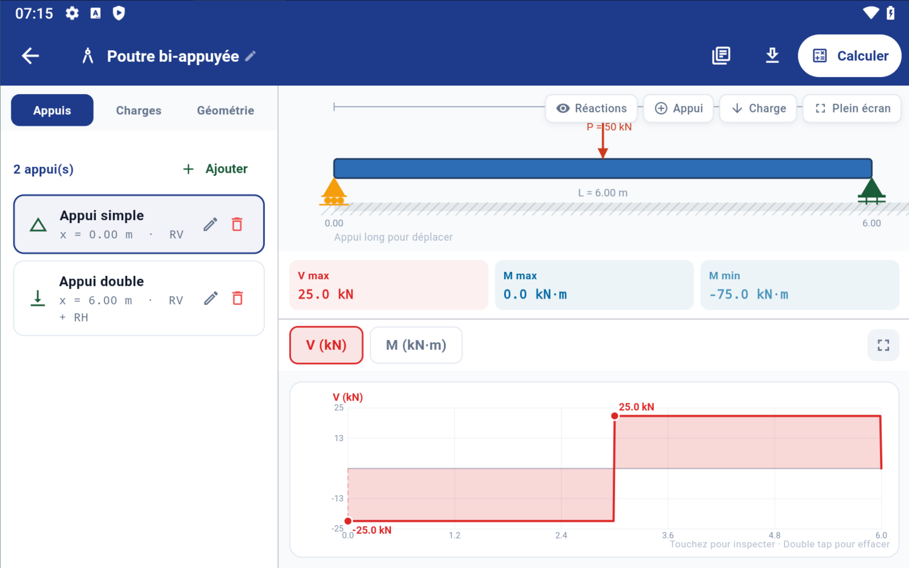
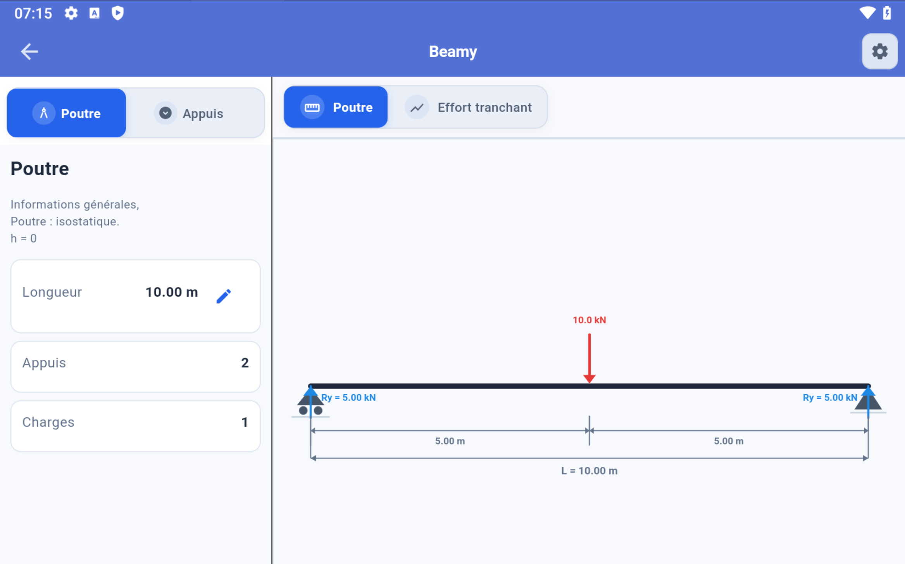

# Roadly

Roadly est une application de génie civil développée avec Flutter et pensée selon une approche **Mobile First** : l'interface et les fonctionnalités sont conçues en priorité pour les appareils mobiles. Elle regroupe des outils de calcul et d'apprentissage autour de plusieurs domaines du génie civil.

## À propos du projet

Je suis **Abbas Imad**, étudiant à l'**USTHB**, et Roadly est avant tout mon projet personnel. Je l'ai créé pour mettre en pratique et améliorer mes compétences en informatique et en développement d'applications, tout en explorant des sujets liés au génie civil. L'utilisation de l'intelligence artificielle m'a aidé à faciliter et accélérer certaines étapes de la programmation, tout en me permettant d'apprendre au fil du développement.

L'application est en cours de développement. Les résultats des modules sont destinés à l'apprentissage et doivent être vérifiés avant toute utilisation dans un projet réel.

## Fonctionnalités

### Dimensionnement des chaussées

Le module Route propose actuellement deux méthodes de calcul :

- **Méthode CBR** : estimation du dimensionnement à partir du trafic, de la proportion de poids lourds, de la croissance du trafic, de la durée de vie visée et de l'indice CBR du sol support.
- **Méthode Asphalt Institute (AI)** : calcul à partir des données de trafic et du sol, avec notamment la répartition des poids lourds et des types d'essieux.

L'écran propose également une option **CTTP**, qui n'est pas encore implémentée.

### Éditeur de poutres et module Ponts

Plusieurs versions de l'éditeur sont disponibles en bêta. Elles permettent notamment de :

- définir une poutre et sa géométrie ;
- ajouter des appuis et des charges ponctuelles ou réparties ;
- lancer le calcul et visualiser les réactions d'appui ainsi que les diagrammes d'effort tranchant et de moment fléchissant ;
- consulter des exemples de poutres dans la version avancée.

La version avancée propose aussi l'export du modèle au format JSON. Les fonctionnalités et les résultats peuvent varier selon la version choisie ; les éditeurs sont encore en développement.

### Autres modules

L'accueil présente également des entrées pour l'hydraulique et les structures métalliques. Ces modules sont prévus pour évoluer au fil du développement de Roadly.

## Captures d'écran

### Accueil



### Dimensionnement des chaussées

| Méthode CBR | Asphalt Institute |
|---|---|
|  |  |

### Éditeur de poutre

| Éditeur — vue 1 | Éditeur — vue 2 |
|---|---|
|  |  |

### Informations et crédits


## Générer et télécharger l'APK Android

Le workflow **Build Android APK** s'exécute automatiquement à chaque push sur la branche `main`. Il peut aussi être lancé manuellement depuis GitHub :

1. Ouvrez l'onglet **Actions** du dépôt.
2. Sélectionnez **Build Android APK**, puis **Run workflow**.
3. Une fois l'exécution terminée, ouvrez-la et téléchargez l'artefact **roadly-android-apk**.

L'artefact contient `app-release.apk`. Cette version est signée avec la clé de debug et est destinée aux tests.

## Technologies et lancement local

- Flutter / Dart

Pour lancer l'application en local, installez Flutter puis exécutez depuis la racine du projet :

```bash
flutter pub get
flutter run
```
